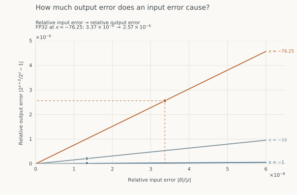

This series develops a reasonably efficient and accurate hardware unit for
`exp2(x)`, the base-two exponential $2^x$. We will use FP32 inputs and outputs,
with a target error of at most two FP32 representable steps (2 ULP) and one
result per cycle per lane. The main application is softmax, so negative inputs
and behavior near zero deserve particular attention.

## Posts in this series

1. **[Computing exp2](exp2-versus-exp.qmd)** **(this post)** — Motivation, base conversion, range reduction, and the choice of polynomial.
2. **[Range reduction, tables and polynomial degree](range-reduction.qmd)** — Why subdivision and higher degree improve the fit, and how they change storage and arithmetic.
3. **[Remez, coefficient search, accuracy testing and hardware cost](remez-and-search.qmd)** — Fit coefficients for finite-precision arithmetic, test accuracy, and compare hardware experiments.
4. **[Generating RTL and searching implementation choices](rtl-producer.qmd)** — Identify circuit choices, generate RTL and improve the implementation through measured experiments.

## Why focus on exponentials?

For one attention head with $M$ queries, $N$ keys and head width $d$,

$$S=\frac{QK^{\mathsf T}}{\sqrt d},\qquad
P=\operatorname{softmax}(S),\qquad O=PV.$$

The rows of $Q\in\mathbb R^{M\times d}$ are queries; the rows of
$K,V\in\mathbb R^{N\times d}$ are keys and their associated values.
$QK^{\mathsf T}$ compares every query with every key. Row-wise softmax turns
these scores into weights $P\in\mathbb R^{M\times N}$, and $PV$ uses those
weights to average the value vectors, producing $O\in\mathbb R^{M\times d}$.
[FlashAttention-2, §2](https://tridao.me/publications/flash2/flash2.pdf)
describes its tiled evaluation and memory costs in more detail.

For a row of scores $s_i$, softmax computes

$$p_i=\frac{e^{s_i-m}}{\sum_j e^{s_j-m}},\qquad m=\max_j s_j.$$

Subtracting $m$ multiplies numerator and denominator by the same factor, so the
weights are unchanged. It prevents overflow by keeping every exponential input
nonpositive; the largest input is zero and produces exactly 1.

The two matrix products require approximately $4MNd$ FLOPs in total
(counting a multiply and an add separately), versus $MN$ exponentials.
Their work ratio is therefore $4d$ FLOPs per exponential.

The relevant matrix dimension is the **attention head width**, not the model's
hidden size. Even very large models use short dot products:

| Model | Query heads | Head width $d$ |
|:------|------------:|---------------:|
| [Llama 3.1 405B](https://github.com/meta-llama/llama-models/blob/main/models/sku_list.py) | 128 | 128 |
| [Qwen3-235B-A22B](https://huggingface.co/Qwen/Qwen3-235B-A22B/blob/main/config.json) | 64 | 128 |

With $d=128$, **both matmuls together provide only 512 FLOPs per
exponential**. A 16,384-token full-attention head has about 137 GFLOPs of
matrix work and 268 million exponentials. Causal masking reduces both counts;
tiling avoids storing the full score matrix but still computes its unmasked
exponentials.

To compare matrix and exponential throughput directly, use **one SM and one
cycle** throughout. If the matrix units produce $F$ FLOPs per SM per cycle,
then at $d=128$ the corresponding demand is

$$R_{\exp}=\frac{F}{4d}=\frac{F}{512}
\quad\text{exponentials per SM per cycle}.$$

The table uses dense matrix arithmetic, counting a multiply-add as two FLOPs.
Both attention matmuls use the listed operand precision; the exponential
remains FP32.

| GPU | Matmul precision | Matmul (FLOPs/SM/cycle) | Exp demand (results/SM/cycle) | FP32 exp capacity (results/SM/cycle) | Demand / capacity |
|:----|:-----------------|-----------------------:|-----------------------------:|------------------------------------:|------------------:|
| H100 | BF16/FP16 | 4,096 | 8 | 16 | 0.5× |
| H100 | FP8 | 8,192 | 16 | 16 | 1× |
| B200 | BF16/FP16 | 8,192 | 16 | 16 | 1× |
| B200 | FP8 | 16,384 | 32 | 16 | 2× |
| B300 | BF16/FP16 | 8,192 | 16 | 32 | 0.5× |
| B300 | FP8 | 16,384 | 32 | 32 | 1× |
| Rubin | BF16/FP16 | 8,192 | 16 | 32 | 0.5× |
| Rubin | FP8 | 32,768 | 64 | 32 | 2× |

For example, B200's FP8 matrix units can do 16,384 FLOPs per SM per cycle.
Dividing by 512 gives a demand of 32 exponentials per cycle, but the FP32
exponential units can produce only 16. **At these peak rates, exponentials alone
need twice as many cycles as the two matmuls.** At BF16, demand and capacity
are equal. Moving to FP8 shortens the matrix work without reducing the number
of scores to normalize.

The Hopper and Blackwell baselines are described in
[FlashAttention-3](https://tridao.me/publications/flash3/flash3.pdf) and
[FlashAttention-4](https://arxiv.org/html/2603.05451v1#S2.SS2).
[NVIDIA's Rubin platform overview, Table 2](https://developer.nvidia.com/blog/inside-the-nvidia-rubin-platform-six-new-chips-one-ai-supercomputer/)
and [architecture comparison](https://developer.nvidia.com/blog/inside-nvidia-rubin-gpu-architecture-powering-the-era-of-agentic-ai/)
give the exponential rates; the FP8/BF16 matrix rates follow the
[NVIDIA-contributed Triton implementation](https://github.com/triton-lang/triton/pull/10936)
and [CUTLASS instruction definitions](https://github.com/NVIDIA/cutlass/blob/147295a3d4b75f3aeff247c25b8927cea9a7006a/python/CuTeDSL/cutlass/cute/nvgpu/tcgen05/mma.py).

Rubin also has a 64-result-per-SM-per-cycle FP16/BF16 exponential path, which
would change the balance if we chose that precision for softmax. Here we keep
FP32 exponentials so the comparison matches our numerical target. Softmax also
needs maxima, sums and normalization; the table isolates its exponential work.
NVIDIA's [Blackwell Ultra measurements](https://developer.nvidia.com/blog/making-softmax-more-efficient-with-nvidia-blackwell-ultra/)
show why increasing SFU throughput particularly helps FP8 attention.

## Why use base two?

Softmax uses $e^x$, but we can compute it using $2^x$:

$$e^x=2^{x\log_2 e},\qquad \log_2 e\approx1.44269504089.$$

Increasing its input by one doubles its
output: $2^{x+1}=2\cdot2^x$. Binary floating point already represents a number
as a significand multiplied by a power of two. If we can compute $2^f$ for $0\leq f<1$,
changing its scale by a power of two is inexpensive. For normal outputs, multiplication by $2^n$ can be implemented by changing
the exponent rather than using a general multiplier.

The identity above is exact, but a rounded multiplication by $\log_2 e$ introduces
error. Simply computing that product in FP32 can change the final answer by tens
of ULPs. Using `exp2` for `exp` requires an adequately precise base conversion.

## Why not compute exp directly?

Direct $e^x$ can also separate a power-of-two scale. Since $e^{\ln2}=2$, split its input at
multiples of $\ln2$:

$$x=n\ln2+r,\qquad e^x=2^n e^r.$$

Choosing $n=\lfloor x/\ln2\rfloor$ leaves $0\leq r<\ln2$. The reduced output
again lies between 1 and 2. Substituting $r=f\ln2$ gives $e^r=2^f$, so the
approximation problem is the same curve expressed in a different coordinate.

The distinction is the input arithmetic. For `exp2`, the interval boundaries
are integers, so the reduction amounts to separating an integer and a binary
fraction. For `exp`, we must locate a multiple of the irrational constant
$\ln2$ and subtract it accurately. An error in that small remainder becomes an
error in the exponential. Implementations such as
[fdlibm's exp](https://netlib.org/fdlibm/e_exp.c) retain extra precision in that
subtraction by splitting the constant into high and low parts.

We choose `exp2` because its reduction and scaling fit binary arithmetic
naturally. Using it for `exp` moves the nonbinary constant into the input
conversion; it does not eliminate the need to represent that constant precisely.

## Error from base conversion

Let $z=x\log_2 e$. If conversion rounds this to $z+\delta$, the exponential is
changed by

$$\frac{2^{z+\delta}-2^z}{2^z}=2^\delta-1\approx(\ln2)\delta.$$

The last approximation is the first-order expansion of $2^\delta$ near zero.
It tells us how an **absolute error in the converted input** becomes a
**relative error in the output**. Even a perfect `exp2` implementation cannot
recover the discarded part of its input.

Consider $x=-1$. Using a high-precision conversion gives

$$z\approx-1.4426950408889634.$$

Rounded to FP32, this becomes $-1.4426950216293335$, a change of about
$1.93\times10^{-8}$. The resulting relative change in the exponential is about
$1.33\times10^{-8}$. In this example, both paths still round to the same FP32
output, $0.3678794503211975$.

Now consider $x=-76.25$. The converted argument is

$$z\approx-110.00549686778346,$$

but its nearest FP32 value is $-110.0054931640625$. Here the change is about
$3.70\times10^{-6}$, giving a relative output change of about
$2.57\times10^{-6}$. The correctly rounded outputs are:

| Computation | FP32 output |
|:------------|:------------|
| $e^{-76.25}$ | $7.674423335919583\times10^{-34}$ |
| $2^z$ after rounding $z$ to FP32 | $7.674443080551257\times10^{-34}$ |

FP32 spacing at these outputs is about $4.59\times10^{-41}$. The two results
are **43 representable steps apart**, or 43 ULPs.

The curves $e^x$ and $2^{x\log_2 e}$ are identical. To see what rounding
changes, compare **relative input error with relative output error** on the
same plot. Each line fixes an original input $x$; moving right means introducing
more relative error into its converted argument. Read upward from that input
error to find the relative error in the exponential.

{#fig-conversion-error fig-alt="One plot with relative input error on the horizontal axis and relative output error on the vertical axis. Lines for original inputs minus one, minus sixteen and minus 76.25 have slopes one, sixteen and 76.25. The highlighted FP32 conversion at minus 76.25 maps 3.37 times ten to the minus eight relative input error to 2.57 times ten to the minus six relative output error."}

Why does the error grow farther from zero? FP32 keeps a fixed number of
significant bits, not fractional bits. Around $|z|=1.44$, adjacent inputs are
$2^{-23}$ apart; around $|z|=110$, they are $2^{-17}$ apart. The latter spacing
is 64 times coarser, allowing a larger absolute $\delta$.

The input error at $x=-76.25$ is only $3.37\times10^{-8}$ relative to
$|z|$, yet the relative output error is $2.57\times10^{-6}$. Since
$z=x\log_2 e$,

$$\left|\frac{2^{z+\delta}-2^z}{2^z}\right|
\approx(\ln 2)|\delta|
=|x|\,\frac{|\delta|}{|z|},\qquad x\ne0.$$

Relative output error is approximately $|x|$ times relative input error:
about 76-fold amplification here.

These examples use a high-precision $\log_2 e$ and round the product once.
Storing the constant in FP32 introduces another error. The reference outputs
above were computed with MPFR; directed lower and upper bounds agree on each
FP32 rounding decision.

To obtain an accurate `exp` from `exp2`, retain enough precision through the
conversion and into range reduction. If a preceding operation already scales
the input, its scale can incorporate $\log_2 e$, but rounding that result to
FP32 still has the effect described above.

## What does computing exp2 require?

A direct table could store the FP32 answer for every FP32 input. But $2^{32}$
entries at 32 bits each would occupy 16 GiB. Instead, we can store polynomial coefficients and evaluate a polynomial
for each input.

Look at $2^x$ on $[-2,2]$. Its value rises from $1/4$ to 4, and its
slope increases by the same factor of 16. A line cannot follow this changing
slope. A quadratic has a slope that changes with $x$, so it can also match
how the exponential bends near a chosen point.

To choose its coefficients, write $p(x)=c+bx+ax^2$. At zero, its value is
$c$, its slope is $b$, and its second derivative is $2a$. We want these to
match $g(x)=2^x$. Since $2^x=e^{x\ln 2}$, differentiating gives

$$g'(x)=(\ln 2)2^x,\qquad g''(x)=(\ln 2)^2 2^x.$$

At zero, $g(0)=1$, $g'(0)=\ln 2$ and $g''(0)=(\ln 2)^2$.
Thus we choose $c=1$, $b=\ln 2$ and $a=(\ln 2)^2/2$:

$$p(x)=1+(\ln 2)x+\frac{(\ln 2)^2}{2}\,x^2
\;\approx\;1+0.693147x+0.240227x^2.$$

Here $\ln 2$ is the natural logarithm of 2, about 0.693147. This is the
**degree-two Taylor polynomial of $2^x$ at zero**. The three matching
conditions determine its coefficients; we have not optimized error across
an interval.

The animation keeps this polynomial fixed and narrows the interval around
zero. Both axes rescale so we can still see the curves.

```{=html}
<section class="sfu-widget" id="reduction-widget" aria-labelledby="reduction-heading">
<h3 id="reduction-heading">A quadratic near zero</h3>
<p class="widget-intro">Zoom from [−2, 2] to [−¼, ¼]. The coefficients stay the same.</p>
<div class="zoom-controls">
<button id="reduction-play" type="button">Play</button>
<span id="reduction-step" role="status">1 of 4 · [−2, 2]</span>
</div>
<div class="plot-legend"><span class="legend-blue">2ˣ</span><span class="legend-orange">Quadratic at zero</span></div>
<svg id="reduction-curve" viewBox="0 0 680 300" role="img" aria-label="Exponential and a fixed quadratic, initially over minus two to two"></svg>
<p class="widget-note">The curves match in value, slope and curvature at x = 0. Away from zero, the terms omitted from the quadratic become larger.</p>
<noscript><p>The quadratic's relative error at x = −2 is about 130%. At x = −½ it is 0.90%, and at x = −¼ it is 0.10%.</p></noscript>
</section>
<script src="../js/sfu-math.js"></script>
<script src="../js/sfu-widgets.js"></script>
```

At $x=-2$, the estimate is about 2.30 times the true value. At $x=-0.5$,
it is about 1.009 times the true value: an error of 0.90%.

## Range reduction

For an exponential, integer intervals are scaled copies of one another.
For any integer $n$,

$$2^{n+f}=2^n\,2^f.$$

For example, on $[-4,-3]$ the values run from $1/16$ to $1/8$.
Multiplying them by 16 gives exactly the curve on $[0,1]$: the same shape,
starting at 1 and ending at 2. Each integer interval differs only by a binary
scale factor.

For any input $x$, choose

$$n=\lfloor x\rfloor,\qquad f=x-n.$$

Then $0\leq f<1$, so the only curve we need to approximate is $2^f$ on $[0,1)$.
For example,

$$2^{-3.25}=2^{-4}\,2^{0.75}.$$

Computing $2^{0.75}$ gives approximately $1.68179283$. Scaling by $2^{-4}$ gives
approximately $0.10511205$. The same approximation to $2^{0.75}$ also serves
$x=-0.25$, $x=2.75$, and every other input with fractional part $0.75$.

This is **range reduction**: replace the original input with a smaller argument
whose function value determines the original answer. At the normal/subnormal
boundary, the result must be rounded to the final subnormal spacing.

For implementation examples, the method notes in
[fdlibm's `exp`](https://netlib.org/fdlibm/e_exp.c) explicitly separate argument
reduction, approximation and scaling by $2^n$.
[Arm's `exp2f`](https://github.com/ARM-software/optimized-routines/blob/master/math/exp2f.c)
uses a finer split, $x=k/N+r$, then combines a table-based scale with a
polynomial for the small residual. Its reconstruction builds the binary scale
through exponent bits.

The animation's 0.90% error at $x=-0.5$ is still far above our two-ULP
target. A bounded interval helps, but we also need a more accurate polynomial.

## Why not just use a Taylor series?

The infinite Taylor series represents $2^x$ exactly. Our hardware evaluates a
finite polynomial, leaving an error. For the quadratic above,

$$E(x)=2^x-p(x)=\frac{(\ln 2)^3x^3}{6}
+\frac{(\ln 2)^4x^4}{24}+\cdots.$$

There are no constant, linear or quadratic terms in this error: matching the
value and first two derivatives at zero eliminated them. Near zero, the error
therefore shrinks like $x^3$. At $x=0.125$, the absolute error is about
$0.000111$; at $x=0.25$, it is about $0.000906$—roughly eight times larger
when the distance from zero doubles. Farther away, the cubic grows and the
remaining terms also matter. At $x=1$, the error is about $0.0666$, or 3.33%
of the true value. The infinite series still converges there; the same
three-term truncation is simply much less accurate.

We can retain more terms, but Horner evaluation then needs more multiply-adds.
We can also shorten the interval, at the cost of more table entries.

Taylor has used all three coefficients to make the error and its first two
derivatives exactly zero at the center. Those conditions leave no freedom to
reduce the endpoint errors. On a symmetric interval around zero, the quadratic
underestimates $2^x$ at the positive endpoint and overestimates it at the
negative endpoint. Increasing its
linear coefficient slightly raises the right side and lowers the left side,
reducing both endpoint errors. It also changes the slope at zero, introducing
a small linear error nearby. We give up some of Taylor's very accurate local
match to improve the worst error across the interval.

For a fixed degree and interval, a **minimax polynomial** minimizes the worst
error. For example, an absolute-error fit of
a quadratic to $2^f$ on $[0,1]$ solves

$$\min_{a,b,c}\;\max_{0\leq f\leq1}
\left|af^2+bf+c-2^f\right|.$$

We can instead minimize relative error by dividing the expression inside the
absolute value by $2^f$. The choice matters because absolute, relative and
FP32-step errors weight the interval differently.

The **Remez algorithm** finds such fits by repeatedly adjusting the
coefficients and the locations of the largest errors. For an unconstrained
quadratic absolute-error fit, the optimum has four ordered points where the
error reaches the same magnitude with alternating signs. Raising the
polynomial to reduce one extreme would worsen another: this balances error
across the interval rather than forcing it to vanish at the center.
[NIST DLMF §3.11(i)](https://dlmf.nist.gov/3.11#i) gives the alternating-error
condition and the equations for iteratively updating the coefficients.
For a detailed account of the algorithm, see §2 of Pachón and Trefethen's
[*Barycentric-Remez algorithms for best polynomial approximation in the chebfun system*](https://people.maths.ox.ac.uk/trefethen/publication/PDF/2009_132.pdf)
(2009). It explains both steps: finding new error extrema and solving for the
next polynomial with equal, alternating errors.

The real-valued fit is a starting point: rounding coefficients and intermediate
results changes its error, so we will also search the actual fixed-point
computation.

## Conclusions

Range reduction gives us a bounded approximation problem and inexpensive binary
scaling. Minimax fitting improves the polynomial at a chosen degree before we
add arithmetic or table entries.

The complete computation still needs to preserve accuracy through input
conversion and rounding, with $2^0=1$ exactly and nondecreasing outputs near
zero. [Part 2](range-reduction.qmd) explores how table resolution and polynomial
degree trade approximation error against storage and arithmetic.
