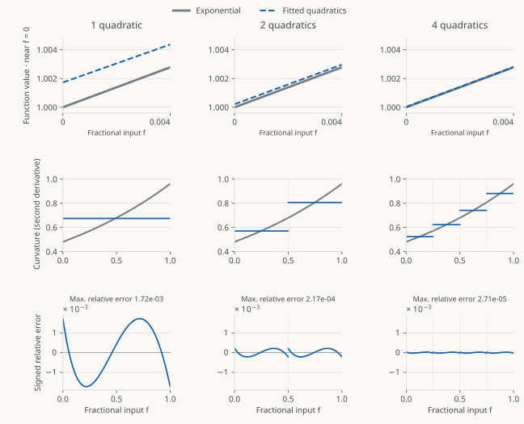
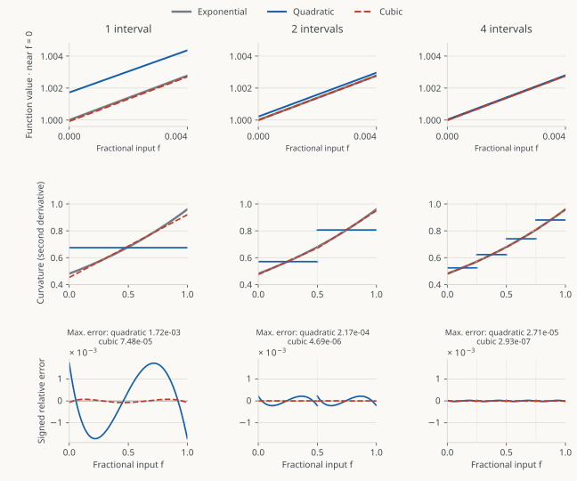

## What we covered in Part 1

[Part 1](exp2-versus-exp.qmd) used $x=n+f$, with $n=\lfloor x\rfloor$ and
$0\le f<1$, to write $2^x=2^n2^f$. We approximate $2^f$ on a fixed interval,
then multiply by $2^n$. For normal binary floating-point outputs, that last
operation changes the exponent.

Even on $[0,1]$, a low-degree polynomial has approximation error. Here we
examine two ways to reduce it: use several polynomials on shorter intervals,
or increase the degree of each polynomial.

## Posts in this series

1. **[Computing exp2](exp2-versus-exp.qmd)** — Motivation, base conversion, range reduction, and the choice of polynomial.
2. **[Range reduction, tables and polynomial degree](range-reduction.qmd)** **(this post)** — Why subdivision and higher degree improve the fit, and how they change storage and arithmetic.
3. **[Remez, coefficient search, accuracy testing and hardware cost](remez-and-search.qmd)** — Fit coefficients for finite-precision arithmetic, test accuracy, and compare hardware experiments.
4. **[Generating RTL and searching implementation choices](rtl-producer.qmd)** — Identify circuit choices, generate RTL and improve the implementation through measured experiments.

## Why use several quadratics after range reduction?

On $[0,1]$, $2^f$ increases from one to two. A quadratic can follow much of
that curve, but its second derivative is constant:

$$p(f)=af^2+bf+c,\qquad p''(f)=2a.$$

The exponential's second derivative increases with $f$:

$$\frac{d^2}{df^2}2^f=(\ln2)^2 2^f.$$

It doubles across the interval. Choosing $a$ to match this curvature near zero
makes the quadratic bend too little near one; matching near one makes it bend
too much near zero. Changing $b$ or $c$ cannot resolve that mismatch because
neither affects the second derivative.

Splitting the interval gives each quadratic its own coefficients. The first
can have a smaller second derivative and the last a larger one. Within each
shorter piece, the exponential's curvature also varies less.

The figures use coefficients that minimize the maximum relative error,
$|p(f)-2^f|/2^f$. Part 3 explains how Remez finds them. Here we use real-valued
coefficients to examine the effect of subdivision first.

{fig-alt="Three columns compare one, two and four quadratic pieces. Close-ups near zero have identical horizontal and vertical limits. The next rows compare second derivatives and signed relative errors on the full interval."}

The maximum relative error falls from $1.72\times10^{-3}$ with one quadratic
to $2.17\times10^{-4}$ with two and $2.71\times10^{-5}$ with four.
Halving the interval width reduces the error by about eight in these fits.

## Selecting the polynomial

A coefficient table stores one set of $a,b,c$ for each interval. Every input
selects one row and evaluates one quadratic, however many rows the table has.

For $N$ equal intervals, define

$$j=\lfloor Nf\rfloor,\qquad t=Nf-j.$$

The figures above use the global coordinate $f$. For evaluation, $j$ selects
the row and $t$ rescales its interval to $[0,1)$; derivatives with respect to
$t$ therefore have a different scale from the plotted derivatives with respect
to $f$.
Row $j$ contains a polynomial approximating

$$2^{(j+t)/N}.$$

For example, with eight intervals and $f=11/16$, we get $j=5$ and $t=1/2$.
We evaluate row 5's polynomial halfway through its interval to estimate
$2^{11/16}$. The coefficients already account for the interval's location, so
there is no extra multiplication by an interval-dependent exponential.

We evaluate the selected quadratic as

$$p_j(t)=(a_jt+b_j)t+c_j.$$

This form uses two multiply-adds. Increasing the number of rows gives us more
coefficient sets without increasing the number of operations for one input.

## What does a cubic add?

$$p(f)=af^3+bf^2+cf+d,\qquad p''(f)=6af+2b.$$

Its second derivative can increase linearly within an interval. A quadratic
has to use one constant second derivative there.

{fig-alt="Three columns compare independently fitted quadratics and cubics with one, two and four intervals. Each shows a common-scale close-up near zero, second derivatives and relative error. Cubics have smaller maximum error for each partition."}

One cubic reaches a maximum relative error of $7.48\times10^{-5}$;
two reach $4.69\times10^{-6}$. Each cubic needs four coefficients and three
multiply-adds:

$$p_j(t)=((a_jt+b_j)t+c_j)t+d_j.$$

## Comparing two implementations

For an illustrative approximation target of $5\times10^{-6}$ relative error,
both of these real-valued fits qualify:

| Design | Maximum relative fit error | Coefficient values | Multiply-add stages |
|:-------|---------------------------:|-------------------:|--------------------:|
| Eight quadratics | $3.39\times10^{-6}$ | 24 | 2 |
| Two cubics | $4.69\times10^{-6}$ | 8 | 3 |

The cubic table has fewer rows and fewer coefficients in total, while its
pipeline needs another multiply-add to sustain one result per cycle.

The operand widths matter too. With $F$ fractional bits for $f$, eight rows
use the leading three bits as an address and leave $F-3$ bits for $t$. Two
rows use one address bit and leave $F-1$ residual bits. Keeping the remaining
bits makes the cubic's multiplier input two bits wider. Coefficient widths
can differ as well: a polynomial spanning a wider interval describes a larger
output change, even though its local coordinate still runs from zero to one.

## Conclusions

We continue with **piecewise quadratics**. Our synthesis experiments show that
small coefficient lookups are much cheaper than multiply-add logic. Shrinking
these tables is therefore very unlikely to pay for a third multiply-add and
its pipeline storage at one result per cycle. We instead investigate more
quadratic rows, retaining two multiply-adds per input, and choose the row count
and bit widths together. [Part 3](remez-and-search.qmd) fits
coefficients for those finite formats and their rounding operations, then
compares the accuracy and circuit area of designs meeting our two-ULP limit.

[Previous: computing exp2](exp2-versus-exp.qmd)
