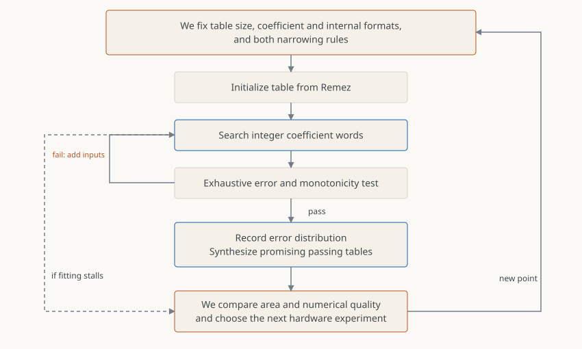
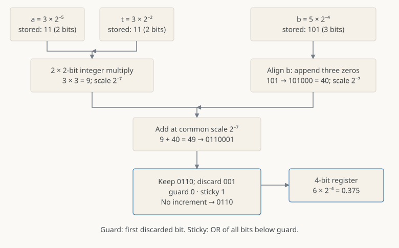
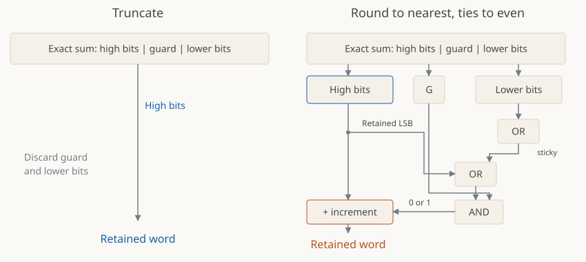
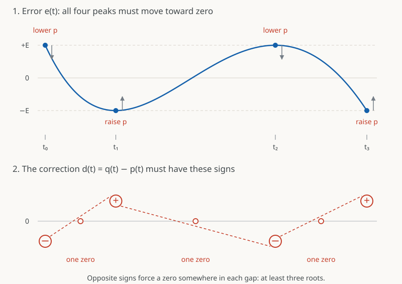
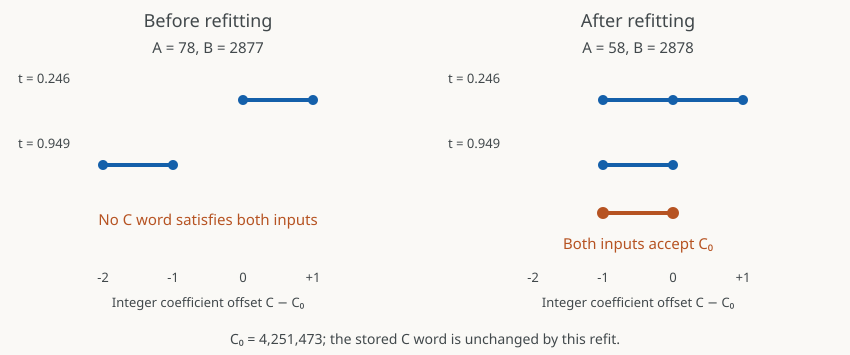
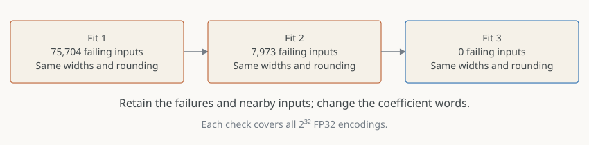
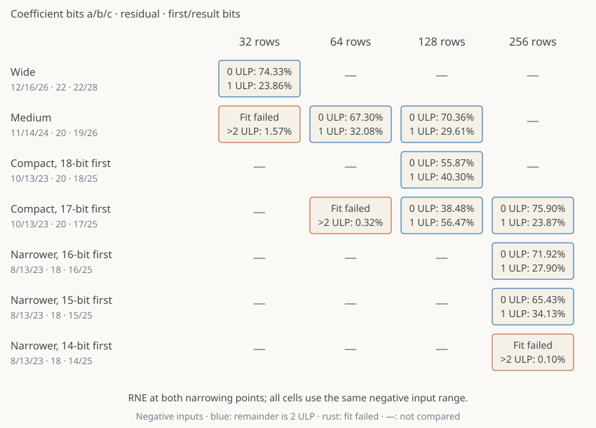

## What we covered so far

[Part 1](exp2-versus-exp.qmd) introduced the identity $2^x=2^n2^f$.
[Part 2](range-reduction.qmd) compared table sizes and polynomial degrees,
showing how more coefficient sets or more arithmetic improve the approximation.
We chose piecewise quadratics: select coefficients from a table and evaluate
$(at+b)t+c$, where $t$ is the coordinate within the selected interval.

We now want an FP32 result within **two representable steps of the correctly
rounded answer**, with particular attention to the nonpositive inputs used by
max-subtracted softmax. We will choose the hardware formats and fit the
coefficients together, accounting for both numerical error and hardware cost.

## Posts in this series

1. **[Computing exp2](exp2-versus-exp.qmd)** — Motivation, base conversion, range reduction, and the choice of polynomial.
2. **[Range reduction, tables and polynomial degree](range-reduction.qmd)** — Why subdivision and higher degree improve the fit, and how they change storage and arithmetic.
3. **[Remez, coefficient search, accuracy testing and hardware cost](remez-and-search.qmd)** **(this post)** — How coefficients, widths and internal rounding are chosen together.
4. **[Generating RTL and searching implementation choices](rtl-producer.qmd)** — Identify circuit choices, generate RTL and improve the implementation through measured experiments.

## Choosing a hardware design point

For each coefficient search, we fix four choices. We start with generous
widths and RNE to establish a working fit before trying to reduce hardware.
Failures, accuracy and measured area then suggest what to change next:

- **Table size:** the number of intervals and coefficient rows. More rows can
  permit narrower arithmetic; fewer rows simplify lookup. At each resolution,
  we revisit the widths and rounding rules.
- **Coefficient formats:** the widths and binary-point positions of $a,b,c$.
  Reducing a width narrows the table and consuming arithmetic but restricts
  the available coefficients. We try reductions separately before combining them.
- **Internal formats:** the width and scale of $t$ and the retained results.
  A narrower $t$ affects both multipliers; a narrower first result reduces
  storage and the second multiplier. Each change also affects numerical error.
- **Narrowing rules:** round-to-nearest, ties-to-even (RNE), or truncation at
  each stage. Truncation removes rounding logic but allows a larger narrowing
  error; refitting may compensate without wider arithmetic.

## The search procedure

We choose the hardware experiments; the fitter searches coefficient words for
each fixed point. Exhaustive failures return to that fit as new constraints.
For each passing table, we measure its error distribution and synthesize its
circuit. We use those results to choose the next experiment.



## Accuracy target

We count representable FP32 steps from the correctly rounded answer: zero ULP
means a match, one ULP means one neighboring value away, and our limit is two.
[MPFR](https://www.mpfr.org/mpfr-current/mpfr.html) supplies the reference.
For background on floating-point spacing and ULPs, see
[Goldberg's “Relative Error and Ulps”](https://docs.oracle.com/cd/E19957-01/806-3568/ncg_goldberg.html#689).

For ordinary finite results, the five acceptable FP32 answers are the correctly
rounded reference, the next two representable values below it, and the next two
above it.
The exact-result cases have their own requirements, including $2^0=1$.
On $[1/2,1)$, FP32 spacing is $2^{-24}$; two such steps are about
$1.19\times10^{-7}$. Part 2's $5\times10^{-6}$ relative error is about 42 times
larger near one.
This tighter target motivates the finer tables explored here.

## Why use fixed point inside an FP32 unit?

FP32 inputs and outputs do not require floating-point arithmetic throughout.
Range reduction separates $2^x=2^n2^f$: we carry $n$ separately while the
polynomial works on a bounded local coordinate $t\in[0,1)$. We can determine
coefficient and intermediate ranges in advance, so each signal can use a fixed
binary scale.

This simplifies the multiply-adds. A general floating-point unit compares
exponents, shifts operands by a data-dependent amount to align them, and
normalizes the result. With fixed scales, the alignment shift is known when
we design the circuit: it becomes wiring that appends zeros or selects bits.
We still choose finite widths and round results when narrowing them.

We therefore unpack the FP32 input during range reduction, evaluate the
polynomial in fixed point, and reconstruct the FP32 output using $n$.
A stored integer $A$ with $F_a$ fractional bits represents $A2^{-F_a}$;
the scale belongs to the signal's format and needs no per-value exponent.

For a small example, take $a=3\times2^{-5}$, $t=3\times2^{-2}$ and
$b=5\times2^{-4}$. The stored integers are 3, 3 and 5:



The product is $9\times2^{-7}$. Appending three zeros to the stored $b$ gives
$40\times2^{-7}$, so the exact sum is $49\times2^{-7}=0.3828125$.
Retaining four fractional bits splits its encoding into `0110 | 001`.
RNE keeps `0110`, representing $6\times2^{-4}=0.375$.

Truncation simply keeps the high bits and errs downward by less than one
retained step. RNE can increment them, limiting error to half a step:



The first discarded bit is **guard**; the OR of all lower bits is **sticky**.
Guard zero keeps the retained integer; guard and sticky both one increment it.
Guard one with sticky zero is a tie, resolved toward an even retained integer:
`0110 | 100` stays `0110`, while `0111 | 100` becomes `1000`.
These are the guard/round/sticky rules with the round bit included in sticky.
Narrowing introduces error; storing a value in a register by itself does not.
[MathWorks' fixed-point examples](https://www.mathworks.com/help/fixedpoint/ug/perform-fixed-point-arithmetic.html)
give further background on alignment and result widths.

## The arithmetic model

For each candidate, we supply the number of rows, the formats of its operands
and results, and its two narrowing rules. `Format(W, F)` means an unsigned
$W$-bit integer word with spacing $2^{-F}$. These parameters stay fixed while
we search the coefficient words.

The model evaluates

$$s=Q_1(at+b),\qquad y=Q_2(st+c).$$

In the pseudocode, $N$ is the row count; each $W$ and $F$ specifies a signal's
width and fractional-bit count. `Q1` and `Q2` select RNE or truncation:

```text
hardware = compile_time {
    rows: N,
    a: Format(Wa, Fa), b: Format(Wb, Fb), c: Format(Wc, Fc),
    t: Format(Wt, Ft),
    s: Format(Ws, Fs), y: Format(Wy, Fy),
    first_rounding: Q1, second_rounding: Q2
}

table = CoefficientTable<hardware.rows, hardware.a, hardware.b, hardware.c>()

Stage1 = MultiplyAdd<hardware.a, hardware.t, hardware.b,
                     Register<hardware.s>, hardware.first_rounding>
Stage2 = MultiplyAdd<hardware.s, hardware.t, hardware.c,
                     Register<hardware.y>, hardware.second_rounding>

model(x, table):
    if exact_case(x): return exact_result(x)
    n, row, t = reduce_input(x, hardware.rows, hardware.t)
    a, b, c = table.read(row)
    s = Stage1(a, t, b)
    y = Stage2(s, t, c)
    return reconstruct_fp32(y, n, RNE)
```

Each stage forms the full product, aligns the addend and narrows the sum.

The residual $t$ and constant $c$ must also travel to the second multiply-add.
Part 4 shows those operand registers and the register cuts inside the multipliers;
here the stage types specify the formats retained after each multiply-add.

The search changes each row's integer coefficient words $A,B,C$. Changing a
template parameter defines a new hardware point requiring its own fit.

## Finding a minimax quadratic

For each interval, we first find a real-valued polynomial to use as a starting
fit. Let $g(t)$ be the exponential on that interval and $p(t)=at^2+bt+c$.
As in Part 2, Remez minimizes the largest relative error,

$$e(t)=\frac{p(t)}{g(t)}-1.$$

At the minimax solution, four error peaks have equal magnitude and alternating
signs. Suppose another quadratic $q$ had a smaller maximum error. At each
positive peak it would have to lower the estimate; at each negative peak it
would have to raise it.

{fig-alt="Top: the error curve has four alternating peaks at plus E and minus E, with arrows pointing toward zero. Bottom: an improving correction must alternate negative, positive, negative, positive. Dashed sign-change guides cross zero in each of the three gaps."}

The correction $d=q-p$ would therefore need **at least three roots**, one
between each pair of peaks. But the difference of two quadratics is also a
quadratic, which can have at most two roots unless it is identically zero.
So no quadratic can make all four errors smaller. This is the alternation
argument; see [NIST DLMF §3.11(i)](https://dlmf.nist.gov/3.11#i).

Remez finds these points iteratively. It begins with four coordinates $t_i$
and solves for $a,b,c$ and an error magnitude $E$:

$$at_i^2+bt_i+c=g(t_i)\bigl(1+(-1)^iE\bigr),\qquad i=0,1,2,3.$$

These are four linear equations in four unknowns. The resulting error is equal
and alternating **at the chosen points**. Elsewhere it may be larger. Remez
locates the actual extrema and uses them as the next four points. Solving again
equalizes the error at those new locations.

The sequence shows three exchanges for one quadratic on $[0,1]$: locate the
peaks, then solve again at those points. We repeat this within each table interval.



We stop when the extrema stabilize and their error magnitudes agree.

## Searching coefficient words

Rounding the Remez coefficients to the table formats gives starting words.
The model also narrows intermediate results, so we search nearby words for an
acceptable FP32 answer after all these operations.

### Acceptable output intervals

Each acceptable FP32 answer is produced by a range of values before final
rounding. The five answers together give us an **acceptable interval**, rather
than a single real-valued target. Working backward through reconstruction gives
the allowed interval for the polynomial result.

This is the idea we borrow from
[Lim and Nagarakatte's RLibm work](https://people.cs.rutgers.edu/~sn349/papers/rlibm32-pldi-2021-preprint.pdf):
fit values that round to acceptable outputs. RLibm targets correct rounding;
we allow two steps and also vary coefficient formats and internal rounding.

Choosing $A,B$ fixes the first multiply-add, including its narrowing. Each input
then constrains only $C$. Working backward through the second narrowing gives
its allowed integer range; intersecting those ranges finds constants that work
for the fitting inputs together:

```text
fit_row(model, table, row, inputs):
    for A, B in coupled_neighbors(table[row]):
        low, high = intersect(allowed_C(model, x, A, B) for x in inputs)
        for C in candidate_words(low, high, table[row].C):
            trial = table.with_row(row, A, B, C)
            keep_if_better(model, trial, inputs)
```

When the intersection is empty, candidate words near the conflicting bounds
can still reduce failures and guide the next proposal. With an overlap, we
can choose a word inside it.

### Choosing coefficient changes

To resolve a conflict, we try nearby $B$ words with compensating changes to $A$,
solving for $C$ after each proposal. Raising $b$ increases the estimate in
proportion to $t$; lowering $a$ opposes that increase most strongly toward $t=1$.

For the worked refit below, a 256-row candidate has the following parameters.
We hold them fixed while changing its coefficient words:

```text
a: Format(8, 24), b: Format(13, 20), c: Format(23, 22)
t: Format(18, 18), s: Format(15, 22), y: Format(25, 23)
first_rounding: RNE, second_rounding: RNE
```

The coefficient words have different scales. In the example below, one unit
of $B$ changes $b$ by $2^{-20}$, while one unit of $A$ changes $a$ by
$2^{-24}$. We therefore try changes of several $A$ units for one $B$ unit,
then refine $A$ with progressively smaller steps. Every proposal uses the
specified rounding operations. We first prefer fewer error-limit and
monotonicity violations; ties are resolved using maximum and total step error
on the fitting inputs.



On the left, the first input requires $C\ge C_0$, while the second requires
$C\le C_0-1$. No constant works for both. After the $A,B$ refit, both ranges
include $C_0$. With that same stored constant, the two errors change from
**one and three ULP to zero and one ULP**.

## Using failures to improve the fit

A table that satisfies the fitting inputs may fail elsewhere. Exhaustive
evaluation supplies failing inputs and their neighbors for another fit.
For this 256-row RNE point, that feedback produces the following progression
without changing any hardware formats:



To accept a candidate, we test the model on every FP32 input. Samples can
reject a candidate early, but cannot establish that it meets the error target.
We also check monotonicity: two neighboring inputs may both meet the error
limit while their outputs incorrectly decrease.

## Measuring the fitted hardware

The numerical checks cover the full FP32 model, including range reduction and
reconstruction. The area, timing and latency measurements here cover the
**coefficient lookup and polynomial pipeline**. We synthesize those blocks
with a common six-cycle implementation at a 1 ns clock and one input per
cycle. Holding that implementation fixed lets us compare tables, formats and
rounding rules. [Part 4](rtl-producer.qmd) changes the register placement and
starts with a four-cycle implementation of the selected fit, then explores
tighter clocks and different register schedules. The numerical results are unchanged.

## From table resolution to operand widths

We first keep both narrowing operations at RNE and vary table size and operand
widths. Each point gets its own coefficient fit and exhaustive checks.
More intervals reduce the coefficient ranges: doubling the rows roughly halves
the linear coefficient and quarters the quadratic coefficient. That suggests
narrower words, but the rounded fits determine which reductions work.

A passing grid cell means we found coefficients meeting the error and
monotonicity requirements. Its percentages count negative approximation inputs
at **exactly zero** and **exactly one ULP**; the remainder is at two ULP.
Their sum is the fraction within one ULP. We compare both that sum and the
zero-ULP fraction, because an exactly-one result can improve a two-ULP error
or worsen an exact result. A failed fit rejects its words, not the format.



The compact 17-bit-first-result fit fails at 64 rows and passes at 128.
At those same widths, 256 rows give many more correctly rounded answers.
That led us to try narrower coefficients, residuals and intermediate results.

The narrower 256-row fits pass with an eight-bit $a$, an 18-bit residual and
a 15-bit first result. Reducing the first result to 14 bits still left failures
after refitting. Combining independently successful width reductions also
failed in some cases, so we restored precision in selected operands and refit.

We also refit the narrower 256-row formats with different narrowing rules.
The comparison below includes those fits alongside the other table sizes
and widths.

## Comparing the fitted designs

The fitter stops at a passing table; we then measure its error distribution.
All candidates use the same negative approximation inputs, with exact-result
bypasses counted separately. The expanded table adds the full approximation
range, near-zero inputs and error direction.

Among the measured candidates, a design remains on the **accuracy/area frontier**
unless another candidate is no larger, matches or improves both accuracy measures in all three
ranges, and improves at least one measure. The remaining tradeoffs let the
application designer choose between area and numerical quality.



**Changing rounding at fixed widths.** At the narrower 256-row,
15-bit-first-result format, two truncations give the smallest measured area. Keeping both RNE stages uses **5.50% more area** and
raises the correctly rounded negative fraction from **53.73% to 65.43%**.
It also lowers the two-ULP fraction from **0.49% to 0.44%**.

**Why removing RNE can increase area.** In the 128-row design with a
17-bit first result, removing the first RNE while leaving the coefficient words
unchanged saves **3.11% of mapped area**. But refitting for truncation changes
the largest ten-bit $A$ word from **510 to 512**. Bit $A[9]$, previously always
zero, becomes variable, restoring lookup, storage and top Booth-digit logic.
The refitted circuit is slightly larger despite losing rounding logic.
The table includes both fits: R/R at **1.083×** area and T/R at **1.086×**.

**Narrowing an intermediate result.** At 256 rows, reducing the first result
from 16 to 15 bits saves **4.45% of mapped area** after refitting. The second
unsigned Booth multiplier drops from nine recoded rows to eight, and storage
shrinks too. The 16-bit fit is more accurate.

**Trading rows for narrower arithmetic.** The 64-row truncation fit produces **62.76%** correctly rounded negative answers and **0.30%** at two
ULP. The 256-row, 16-bit-first-result truncation fit is smaller and produces
fewer correctly rounded answers (**59.91%**), but fewer two-ULP answers too
(**0.14%**).

**Retaining wider arithmetic.** Among these fits, the highest correctly rounded fraction is
**75.90%**, from a wider 256-row RNE fit with **23.43% more area** than the
smallest measured circuit.

## Conclusions

Searching the rounded computation recovered accuracy without always adding
bits. Hardware reasoning suggested which formats to investigate, while fitted
constants and synthesis sometimes changed the expected cost. We therefore
explored neighboring choices and compared accuracy distributions alongside
area, leaving the application designer to judge the tradeoffs.

[Part 4](rtl-producer.qmd) develops one small-area candidate: 256 rows,
8/13/23-bit coefficients, an 18-bit residual, 15- and 25-bit results, and two
truncations. Holding its numerical behavior fixed lets us explore circuit
structure and pipelining separately. The more accurate fits remain alternatives.
