## From a fitted polynomial to RTL

[Part 3](remez-and-search.qmd) chose a table, coefficient words, internal
widths and rounding rules. We now hold that candidate's numerical behavior
fixed and investigate circuits that evaluate it once per cycle.

**This article uses synthesis and cell mapping only.** Placement, routing and
clock-tree construction can substantially change timing and power, and require
additional buffering, cell sizing and setup/hold repair. Ideally, those physical
results would guide which implementation choices we explore next. We use
synthesis here to keep the exploration simpler and focus on how circuit choices
affect the generated implementation.

Can we keep the same pipeline at 1 ns, 800 ps and 700 ps, or do we need
faster adders, different compression, or more registers?

We wrote a **parameterized RTL generator** to explore these implementations.
It takes the fitted numerical design and our choices of recoding, compression,
carry logic and register placement. It generates the arithmetic, delays the
operands to their consuming stages, and builds the corresponding testbench.
We can move a cut or replace an adder without hand-editing every dependent
signal path.

We extended the generator as experiments suggested new carry structures and
register cuts.

## Posts in this series

1. **[Computing exp2](exp2-versus-exp.qmd)** — Motivation, base conversion and the mathematical approach.
2. **[Range reduction, tables and polynomial degree](range-reduction.qmd)** — How subdivision and degree change the approximation.
3. **[Remez, coefficient search, accuracy testing and hardware cost](remez-and-search.qmd)** — Fit coefficients for finite arithmetic and compare accuracy and area.
4. **[Generating RTL and searching implementation choices](rtl-producer.qmd)** **(this post)** — Produce and compare circuits for a fitted design.

## The computation we implement

All experiments use the same 256-row quadratic and accept one input per cycle.
It contains two multiply-adds (MACs):

$$s=Q_1(at+b),\qquad y=Q_2(st+c).$$

The coefficients occupy **8/13/23 bits**, the residual $t$ occupies **18 bits**,
and the retained results occupy **15 and 25 bits**. Both internal narrowing
operations truncate. These formats and the fitted words come from Part 3;
we keep them fixed while changing the circuit.

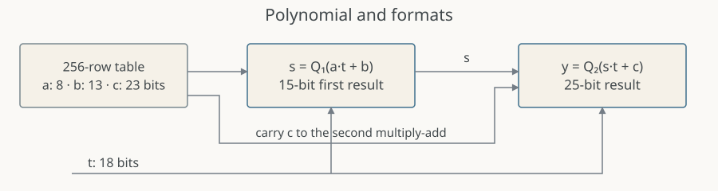

Our starting implementation uses four cycles: lookup, the complete first
MAC, then two cycles for the second MAC. That second MAC stores unfinished
arithmetic between compression and carry completion. We will investigate what
crosses that cut and how much work belongs on either side.

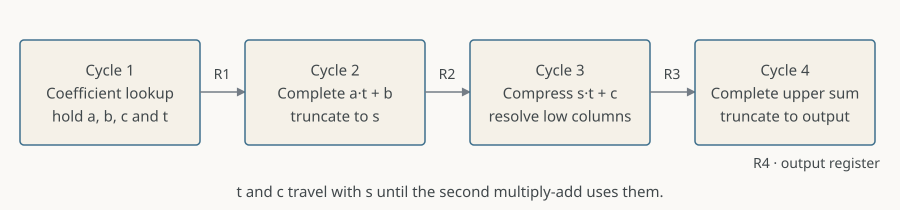

## Design choices

### Booth recoding and decoder placement

The two products are $a\,t$ and $s\,t$, where $s=Q_1(at+b)$.
We choose which operand to recode and whether to keep its decoded controls
between stages.

A binary multiplier adds shifted copies of an operand. For $13\times7$,
$7=1+2+4$ selects $13+26+52$.
[Radix-4 Booth recoding](https://en.wikipedia.org/wiki/Booth%27s_multiplication_algorithm)
uses digits $0,\pm1,\pm2$: $7=-1+2\times4$ selects just two nonzero terms.

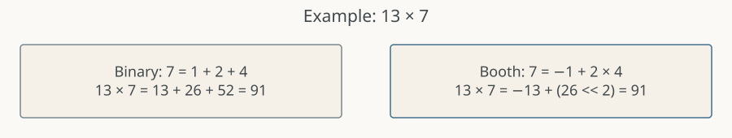

The generator offers three alternatives:

| Choice | What changes | When it may help |
|:--|:--|:--|
| Recode $a$ and $s$ locally | Five and eight rows of multiples of the 18-bit $t$; carry raw $t$. | Fewer rows reduce compression work. |
| Recode $t$ locally | Ten rows of multiples of the narrower $a$ or $s$; two decoders. | Narrower rows may offset the greater row count; no decoded controls need storage. |
| Recode $t$ once | Same product rows, one decoder; carry 27 controls instead of 18 residual bits. | Nearby uses need fewer extra control registers. |

In our four-cycle schedule, carrying those controls through two banks adds
18 flip-flops.

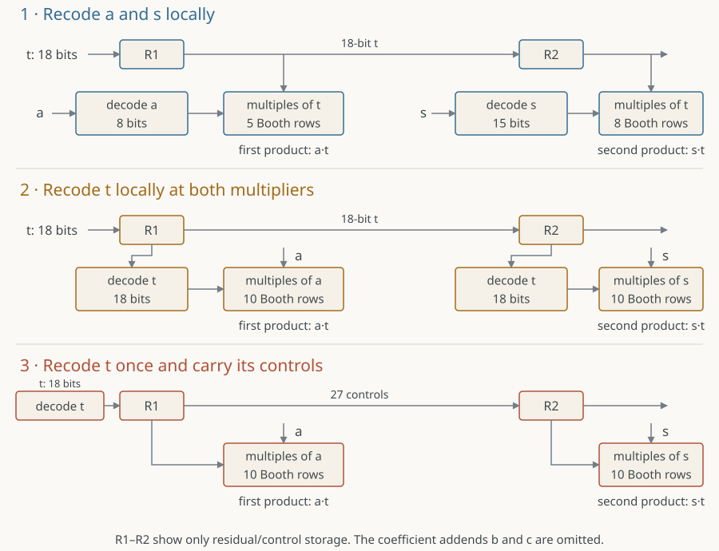{fig-alt="All three choices: local a/s decoding, local t decoding, and shared t decoding. Register banks show the residual or controls carried between uses; other carried operands are omitted."}

These unsigned row counts include leading-zero padding.

### How to compress the rows

A multiply-add has several terms to sum: the product rows and the coefficient
being added. Adding them one at a time would repeatedly wait for carries to
travel across a word. Instead, we reduce the number of terms **without completing
each addition**. We keep sum bits and carry bits separately until only two
rows remain, then use one carry-propagating adder.

The building block is a **3:2 compressor**, which is just a full adder. It takes
three bits of the same weight and produces two bits: a sum at that weight and
a carry at twice the weight. For example, three ones become a sum of one and a
carry of one: $1+1+1=1+2$. Nothing has been discarded.

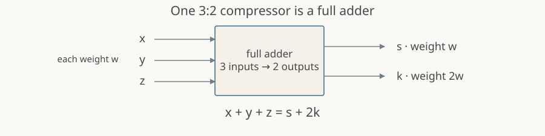

Each compressor uses only its three input bits. It does not wait for a carry
from the neighboring column. That lets many compressors operate in parallel;
their carry outputs become inputs to a later layer. This is **carry-save addition**; see
[Parhami, *Computer Arithmetic*, Chapter 8](https://web.ece.ucsb.edu/~parhami/text_comp_arit.htm).

#### A small complete multiply-add

Consider $u\,v+b$, with a three-bit $u$, two-bit $v$ and two-bit $b$.
The six partial-product bits are $p_{ij}=u_i\mathbin{\&}v_j$: each is the output
of an AND gate. The bits selected by $v_1$ have twice the weight of those
selected by $v_0$, giving this layout:

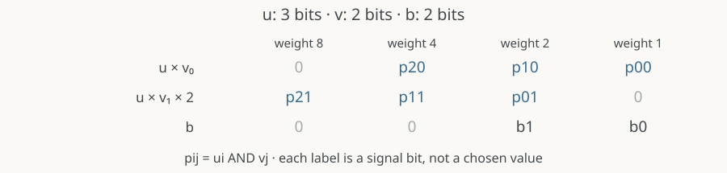

We now have two grouping choices. Both circuits below include every input bit
and the final addition. **FA** denotes a full adder; **HA** denotes a half adder,
which adds two bits into a sum and carry. A full adder with one input fixed at
zero simplifies to a half adder.

| Grouping | This small circuit | When it may help |
|:--|:--|:--|
| Whole rows | One FA at weight 2 and HAs at weights 1 and 4, all in parallel; weight 8 passes through. | A tight stage benefits from parallel work before the final adder. |
| Column packing | One FA at weight 2; its carry feeds a second FA at weight 4. Pairs wait for the final adder. | With enough stage time, a sparser stored pair can save registers. |

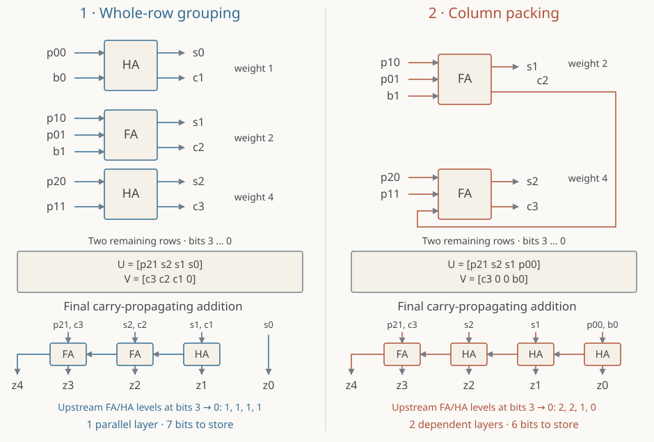{fig-alt="Complete circuits for both choices. Named wires connect compression to rows U and V and the final ripple adder. High bits are on the left; carries travel left toward higher weights."}

Including the final ripple adders, **both circuits use three FAs and three HAs**.

A register between compression and the final addition would store **seven
signal bits** on the left and **six** on the right; fixed zeros need no storage.
Column packing saves a bit here, but puts two dependent FAs before that register.

The final adder also sees different arrival patterns. In the column-packed
example, the low pair `p00,b0` needs no compression, `s1` needs one FA, and
`s2,c3` need two dependent FAs. The row-grouped circuit produces its compressed
bits in one parallel layer.

Our Booth products, correction terms and aligned coefficient make a larger,
sparser version of this problem. In the starting pipeline, grouping affects
the bits stored inside the second MAC and the paths feeding its final adder.
We therefore need to choose the carry network together with compression.

### How to complete the sum

The carry diagrams keep high bits on the left and show incoming compressor
delays vertically. Final-adder carries $k_i$ differ from the compressor
outputs `c2,c3`.

A **ripple adder** passes the carry from one bit to the next. A **prefix
adder** computes carries for many positions in parallel by combining summaries
of how groups of bits generate or propagate a carry.

For two input bits, $G=A\mathbin{\&}B$ means they generate a carry, and
$P=A\mathbin{\oplus}B$ means they propagate an incoming carry. Each dot in
the prefix diagrams combines two adjacent groups:

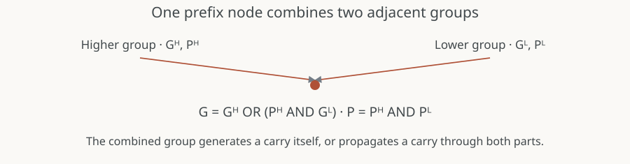

For an $N$-bit sum, the structural tradeoff is:

| Completion | Logic and carry dependency | When it may help |
|:--|:--|:--|
| Ripple | $O(N)$ gates, with up to $O(N)$ serial carry steps. | The chain is short enough, or early low inputs let carries advance during compression. |
| Dense prefix | $O(N\log N)$ gates for $O(\log N)$ carry depth; more connections. | A long carry dependency limits timing and justifies the extra logic. |
| Hybrid | Replace some prefix logic with a low ripple chain; use prefix above it. | Low inputs arrive early enough to ripple while the upper groups form. |

Our generator uses a dense prefix network. Other topologies, such as
Brent–Kung, use $O(N)$ prefix cells with more logic levels; see
[Harris, *A Taxonomy of Parallel Prefix Networks*](https://pages.hmc.edu/harris/research/taxonomy.pdf).
These counts describe the structure before constant folding and cell mapping.

Early low bits can start adding while compression still produces upper bits. A late input's remaining
path to the output determines whether faster carry logic helps.

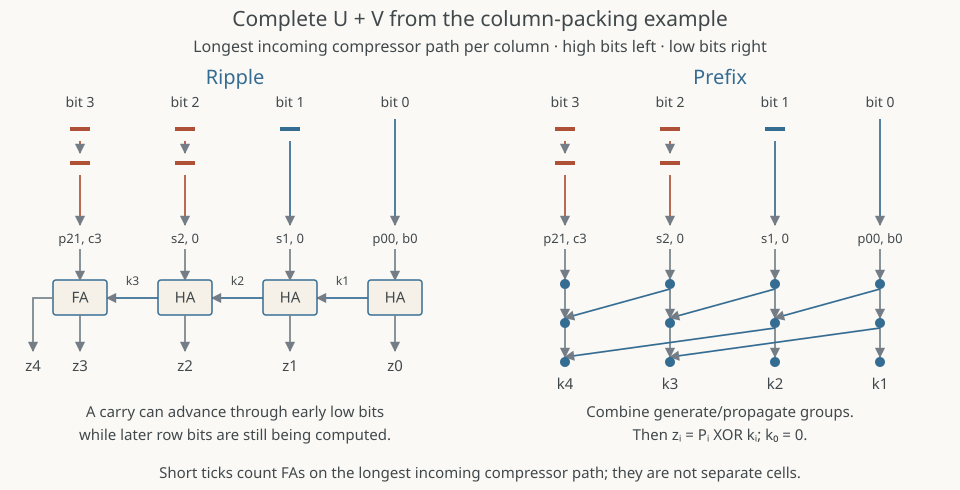{fig-alt="Ripple and prefix completion of the preceding column-packed sum. Vertical paths show the compressor dependencies feeding each column; high bits remain on the left."}

A **hybrid** uses ripple in a low portion and prefix above it. In this small
example, bit 0 can form its carry while the first FA computes `s1`. The next
low carry can advance while the second FA computes `s2,c3`. The upper prefix
groups compute from their own row bits and consume that low carry when it arrives.

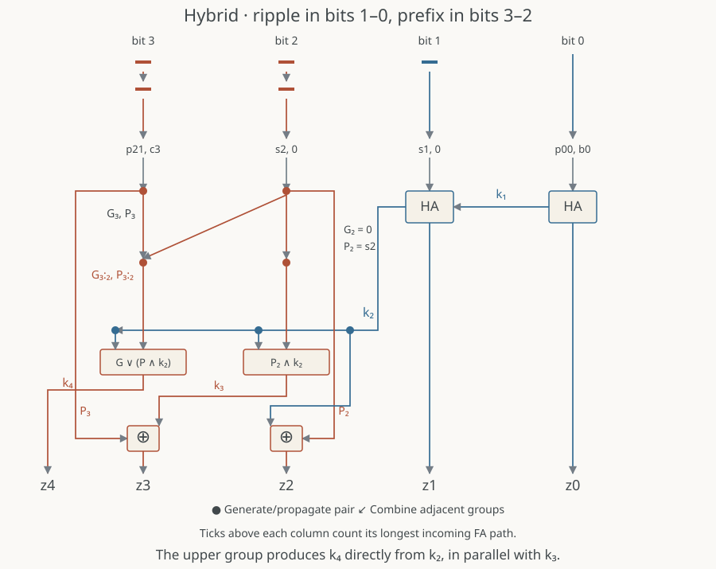{fig-alt="The connected hybrid network uses the same bit columns and incoming compressor paths as the ripple and prefix comparison. The low ripple carry feeds both upper carry calculations."}

Here `P3:2 = P3 AND s2` tells us whether both upper bits propagate a
carry. The top carry combines that group with `k2` directly; it need not wait
for `k3`. The XOR gates produce the remaining sum bits.

We choose the ripple span so its carry reaches the upper network in time.

#### Separate and unified carry networks

Suppose we add two numbers, then truncate bits 1–0 and retain bits 2 and
above. The **numerical boundary** is that divide between discarded and retained
bits. We still need the carry from the low bits: `11 + 01` produces `100`, so
simply ignoring those bits would make the retained answer too small.

One implementation completes the low addition to obtain $k_2$, then supplies
that carry to a separate upper adder. A register at this point must store
$k_2$ along with the unfinished upper operands. Without that register, we can
build **one carry network across all the columns**. Its prefix groups can
combine low and high columns directly, instead of passing a completed $k_2$
between two separately constructed adders. We call this unified completion.

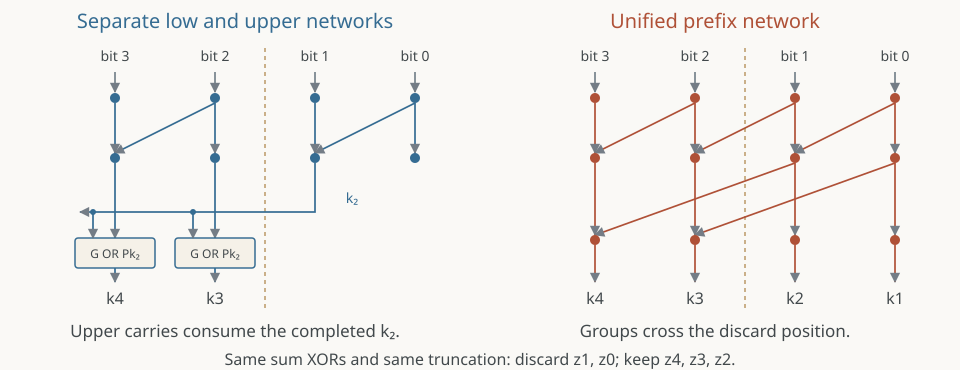

The carry structure can therefore change somewhere other than the discard
position. Our first MAC discards below bit 20, while its unified hybrid changes
from ripple to prefix at bit 8. The prefix spans discarded and retained columns.

### What crosses a register boundary

An earlier register stores more unfinished bits, but gives the logic before it
less work. Our small example starts with eight variable input bits; each FA
replaces three with two, reducing storage by one bit. The same two compressors
allow three cuts:

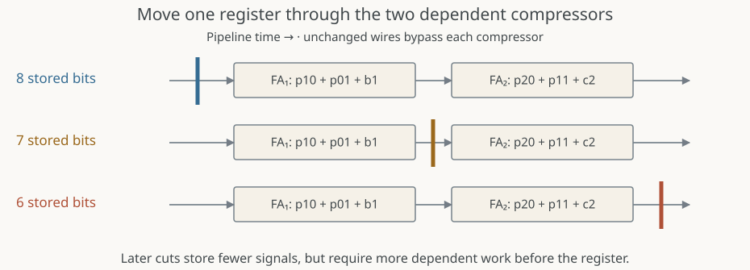

After compression, we can also choose how much low-column addition precedes storage.

For example, write $30$ as `0001|1110` and $66$ as `0100|0010`, with
the bar separating the four low bits we will discard. Those low parts are
`1110` (14) and `0010` (2). Their sum is `1|0000`: four zero bits and a carry
into the retained portion. The upper parts therefore add to $1+4+1=6$,
giving `0110|0000` (96) before truncation. Once that carry is known, we no
longer need to store the low bits:

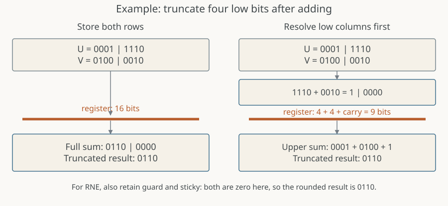

| Register cut | What crosses it | When it may help |
|:--|:--|:--|
| Earlier in compression | More unfinished row bits. | Less work before the register can meet a tighter clock. |
| Later in compression | Fewer row bits, with more dependent work already done. | Spare stage time can reduce storage. |
| After low-column addition | Upper row bits and the low carry; RNE also needs rounding information. | Resolving discarded columns can avoid storing them. |

These cuts move exact work between cycles and preserve the fitted narrowing
rules. For RNE, the retained rounding information includes guard and sticky.

## What the generator takes and builds

The generator has two inputs. The **numerical design** contains the fitted
coefficient table, the width and binary point of each operand and result, and
the two narrowing rules. The **implementation configuration** chooses how to
build that computation:

| Choice | What changes in the generated circuit |
|:--|:--|
| Recoded operand and decoder placement | Booth rows, local decoders or carried controls |
| Row grouping or column packing | Compressor connections and the two rows left for addition |
| Carry network, separately for each MAC | Ripple, prefix or hybrid logic, including its split position |
| Carry grouping | Separate low/upper adders at the numerical boundary, or unified completion across it |
| Register cuts | Stages for operands and results, compression layers before storage, and low columns resolved before a cut |

For example, the four-cycle 800 ps configuration uses a complete hybrid first
MAC and a split ripple second MAC:

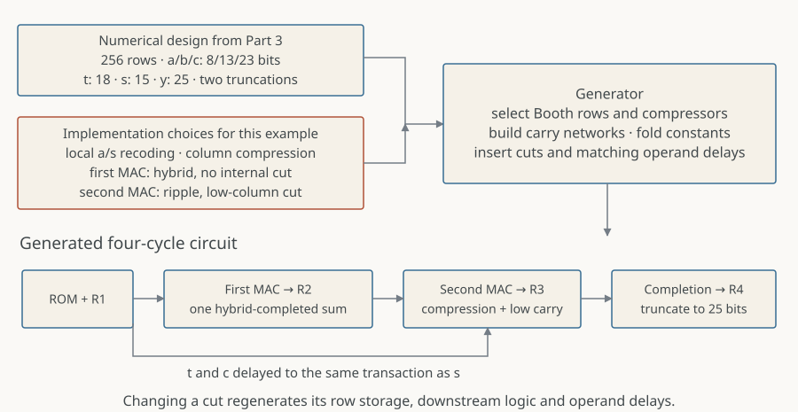{fig-alt="A concrete generator configuration and the four-stage circuit it produces. The generator constructs the selected arithmetic and the delays needed by its schedule."}

When $s$ arrives after two cycles, the second MAC needs $t$ and $c$ from that
same input. Moving a cut changes these delays. The generator tracks each
signal’s stage and inserts registers to keep transactions aligned.

It also knows the table's constants before inserting registers. In this fit,
$c[22]$ is one in every row. That bit needs no table selection or carried
flip-flops: it enters the later arithmetic directly as a constant one.

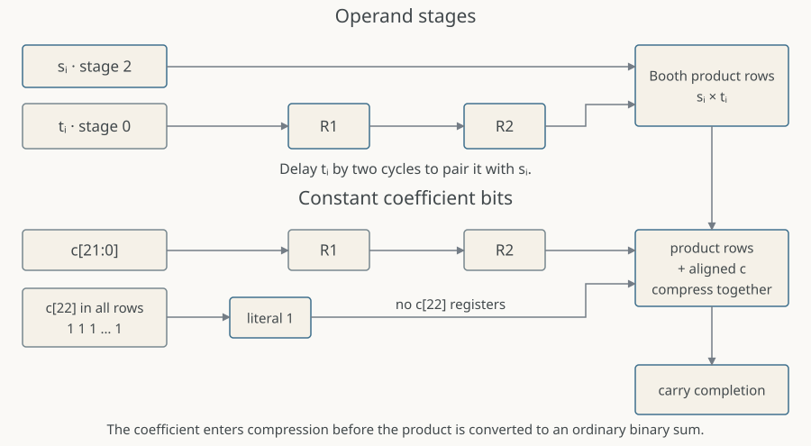

The coefficient joins the product rows before compression, so one carry network
completes the multiply-add. Completing the product first would require another
carry-propagating addition for the coefficient.

## Exploring the choices

We begin with local narrow-operand recoding, whole-row compression and ripple
carry completion. For each clock, we first ask whether that implementation
meets timing. If it does, smaller logic or less storage may improve it. If it
does not, we inspect the limiting stage: speeding up an adder elsewhere would
leave the clock failure unchanged.

Our experiments use the following flow; we choose the next change from the
measured paths and tradeoffs:

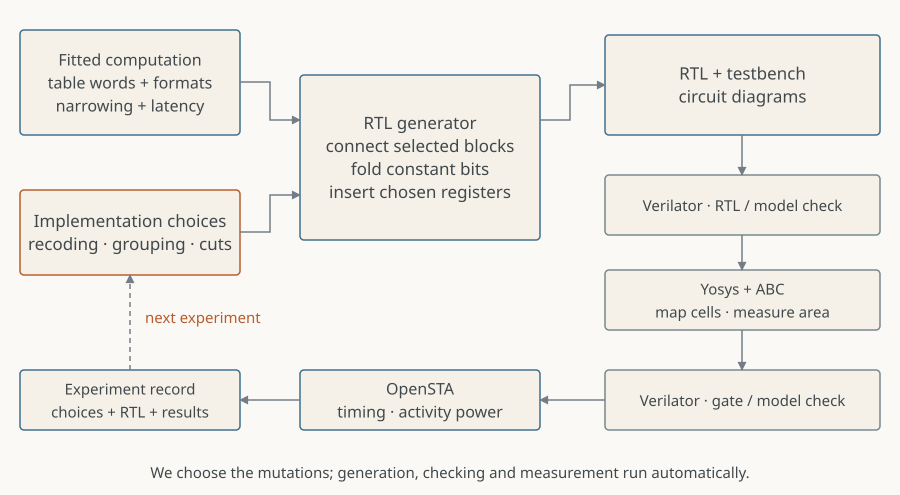

Each extension to the generator needs checking too. We compare generated RTL
and mapped-gate behavior against the arithmetic model, including transaction
alignment across register cuts. Configurations, RTL and measurements are
retained for comparison.

Changing the clock starts a new comparison. We remap each circuit for that
target, rather than subtracting the period change from an earlier timing result.
The fitted computation stays fixed throughout.

Our flow uses [Yosys](https://yosyshq.readthedocs.io/projects/yosys/en/latest/)
and [ABC](https://github.com/berkeley-abc/abc) for synthesis and mapping,
[Verilator](https://verilator.org/guide/latest/) for RTL and mapped-gate checks,
and [OpenSTA](https://openroad.readthedocs.io/en/latest/main/src/sta/README.html)
for timing and activity-based power. We use [ASAP7](https://asap.asu.edu/)
RVT TT cells and investigate **1 ns, 800 ps and 700 ps** clocks. Simulation
activity uses the corresponding clock for each power measurement.

The measured block includes **coefficient lookup and the polynomial pipeline**.
Area is mapped cell area; timing and power use cell and pin-load models.
Range reduction and FP32 reconstruction are outside these measurements.

## Choosing an implementation at 1 ns

At 1 ns, the four-cycle starting schedule meets timing with whole-row
compression and ripple carry. It occupies
**319.127 µm²**. We next try column grouping: the small example above suggested
it could reduce the signals stored between compression and carry completion.

The difference appears in the two rows entering the second MAC's register:

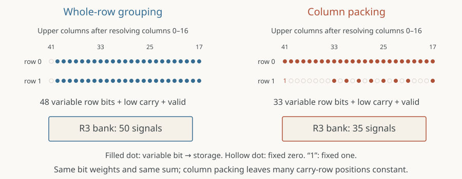

Column packing leaves more constant positions in the carry row, reducing the
register bank from **50 to 35 bits**.
Across the circuit, mapped flip-flops fall from **194 to 178**, and area falls
to **296.470 µm²**. The first MAC has no internal bank to shrink, but its
compression logic also changes. It limits timing with **89.37 ps** of slack;
the changed dependencies still fit the 1 ns cycle.

With column compression, local `a`/`s` recoding also uses less area than either
`t` alternative: **296.470 µm²**, versus **308.761 µm²** for local `t` decoding
and **307.303 µm²** for carried controls. Sharing the decoder saves logic, but
requires more control storage; it does not produce the smallest circuit here.
We keep local `a`/`s` recoding for the tighter-clock experiments.

At 1 ns we keep four cycles, column compression, low-column resolution and
ripple completion. Ripple meets this clock target.

## Keeping four cycles at 800 ps

We first remap the four-cycle ripple circuit for 800 ps. The complete first
MAC misses timing, while both second-MAC stages still pass. That points us
toward the first MAC's carry network before adding a stage.

Each snapshot shows minimum setup slack per stage: rust marks failure, amber
the least passing margin. We remap every circuit, so unchanged stages can also
have different margins.

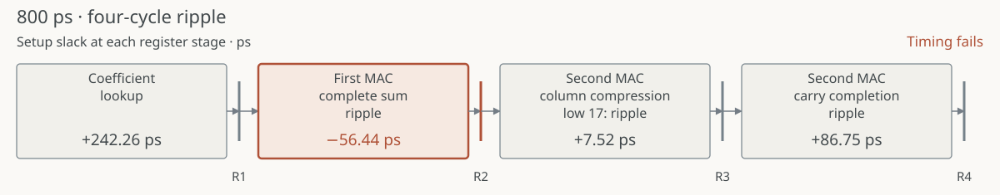

**Separate prefix networks.** The original construction completes discarded
low columns and retained upper columns with separate carry networks. Replacing
both with prefix completion improves the first MAC, but R2 still fails.

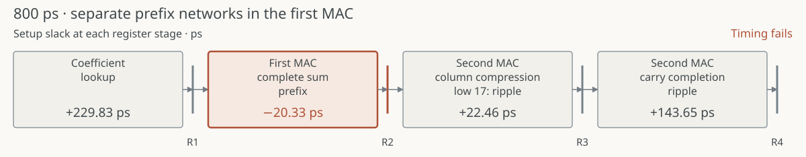

**One prefix network.** There is no register between those two networks in
the four-cycle schedule. We can build a single prefix network across the sum,
including both discarded and retained columns. This almost closes timing,
but the first MAC still misses by **1.65 ps**.

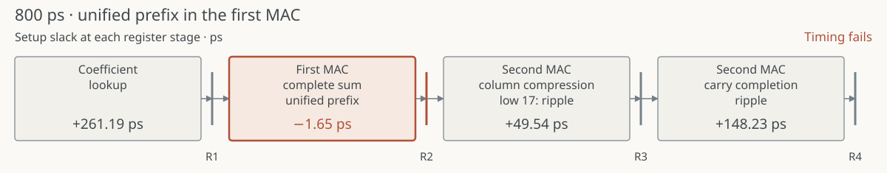

**A unified hybrid.** We next ripple through the lowest eight columns and
use prefix completion above them. In this fit, the second compressed row is
zero in columns 1–7, simplifying the low carry to a short chain of AND gates.
The prefix network starts at column 8 and spans the numerical narrowing
boundary at column 20; the eventual truncation is unchanged.

Both worst paths run from `a[3]`, through
column 22, to `s[14]`; neither is limited by the low ripple chain. The diagram
follows the actual mapped cells after the column-22 propagate signal:

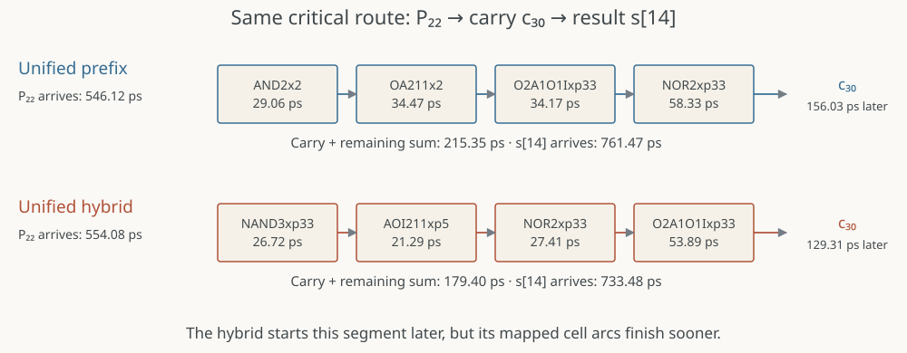

ABC maps our Boolean RTL to library cells. For the hybrid, it chose a faster
four-cell carry segment, which made up for the later input.

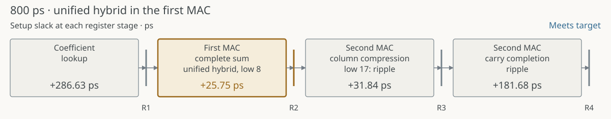

**Another cycle instead.** We also split the first MAC into compression and
carry-completion stages, retaining ripple throughout. That resolves its timing
problem, but adds **61 register bits**. The limiting stage moves to the second
MAC's compression and low-column sum.

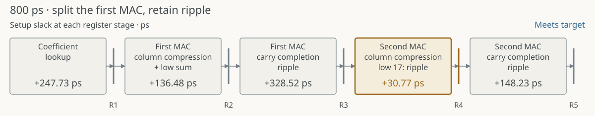

| At 800 ps | Cycles | Area (µm²) | Setup slack (ps) | Power (mW) |
|:--|--:|--:|--:|--:|
| Ripple | 4 | 296.543 | −56.44 | 1.0582 |
| Unified hybrid in first MAC | 4 | 299.561 | 25.75 | 1.0621 |
| Split first MAC, ripple | 5 | 313.703 | 30.77 | 1.1810 |

Both alternatives meet timing, but the hybrid has lower latency, area and
power. At 800 ps, extra carry logic costs less than the storage for another
cycle.

## Compression and register cuts at 700 ps

### Can we keep five cycles?

At 700 ps, the four-cycle ripple circuit fails in both MACs. We first try faster
carry completion, then an extra cycle and changes to the work around its cut.

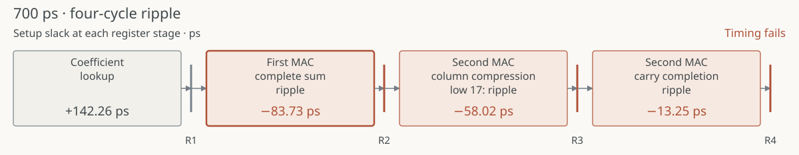

**Prefix completion in both MACs.** This makes the second MAC's final stage
pass, but its compression/low-column stage and the complete first MAC still
fail.

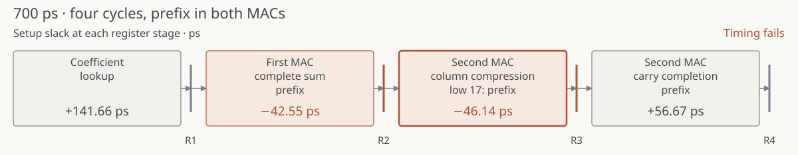

**Split the first MAC.** Giving its compression and completion separate
cycles makes that MAC pass with ripple. The second MAC's compression and
low-column sum now form the only failing stage, at R4. The following stage
has **48.23 ps** of slack, suggesting we could move some work across their
boundary.

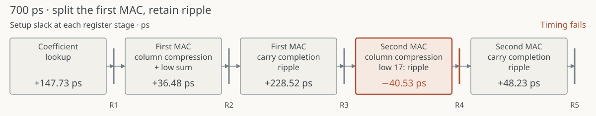

**Faster low-column addition.** Before moving the boundary, we tried a
block-lookahead low adder, using eight-bit blocks in the second MAC. R4 still
fails, with a worse margin. Its path includes product selection and compression
as well as this addition; replacing the local adder is insufficient.

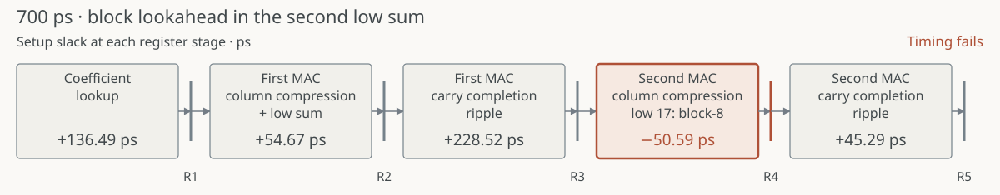

**Resolve fewer columns before storage.** The original cut completes 17 low
columns before R4. Completing only 15 moves two unresolved columns into the
following cycle. The numerical truncation still removes 17 columns after the
sum is finished.

The 15-column cut improves R4 from **−40.53 to −16.61 ps**, but does not close it.

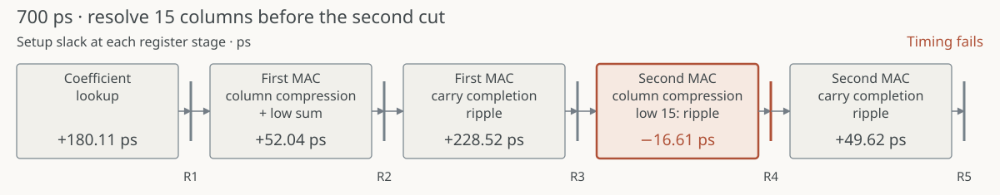

Moving another two columns leaves only 13 resolved before R4. This gains just
another **2.36 ps**. R5 has more margin, but R4 still fails.

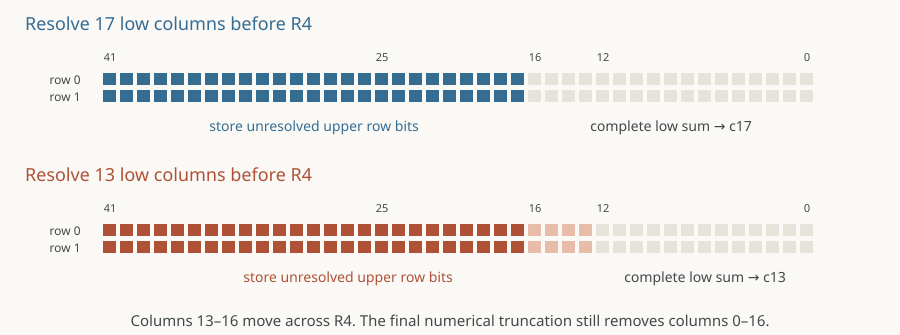

**Whole-row grouping.** We return to the 17-column cut and change compression
instead. As the small example showed, whole-row grouping does some work in
parallel that column packing leaves dependent. Its stored pair is denser—the
opposite tradeoff to our 1 ns storage reduction—but the five-cycle mapped
circuit now meets 700 ps. Both stages of the second MAC have little margin.

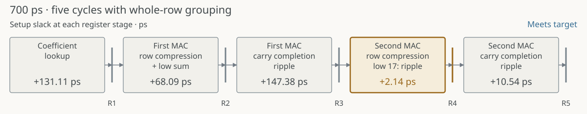

### Reducing storage in a six-cycle pipeline

We also retain column grouping and
put R4 immediately after product selection. Compression and the low-column
sum move to R5, with completion at R6. This passes comfortably, but R4 stores
**189 bits** of unfinished rows. The stage feeding that bank has **372 ps**
of spare time, suggesting we could compress before storing.

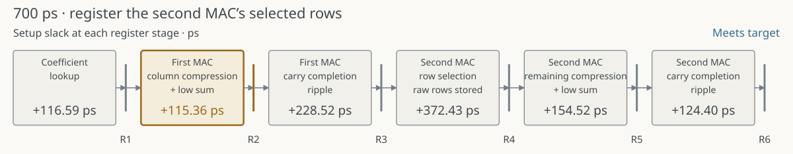

**Compress before the new register.** We move compression layers before R4
and regenerate the remaining logic and operand delays. Three, four and five
layers progressively reduce storage while consuming its spare time:

Three layers leave **87 bits**; R4 still has ample margin.

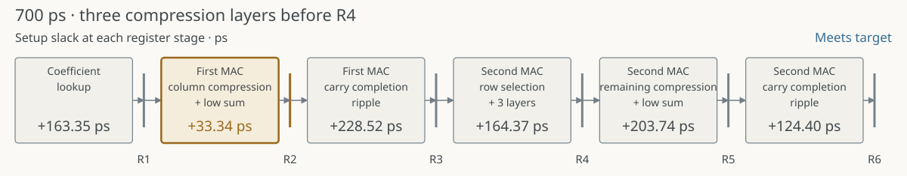

Four layers leave **74 bits** at R4 and **99.63 ps** of local slack.

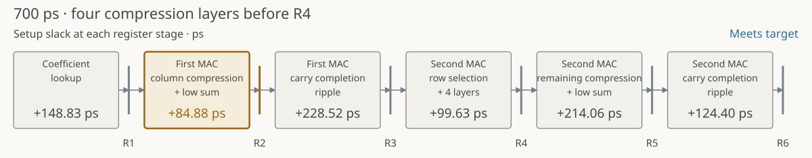

Five layers leave **66 bits** and **82.78 ps** at R4. The first MAC now limits
the pipeline at **55.21 ps**, suggesting we can try completing compression.

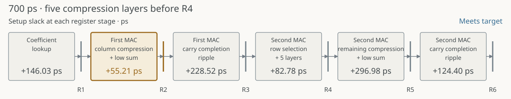

**Finish compression before R4.**

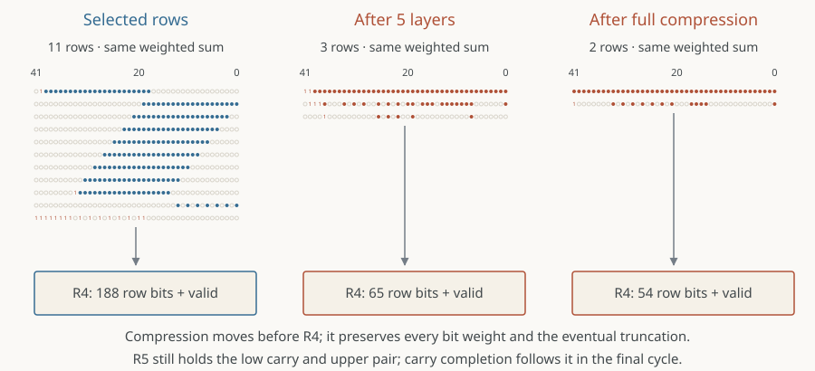

Completing compression leaves 54 variable row bits plus valid: **55 bits**
instead of 189. Only low-column addition remains between R4 and R5. Mapped
area falls from **371.644 to 332.788 µm²**, and the pipeline still passes,
but R4 is now limiting at **2.08 ps**.

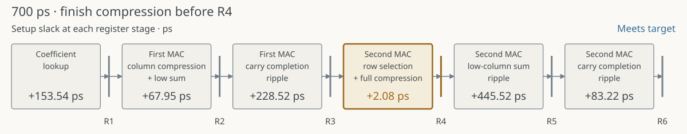

| At 700 ps | Cycles | Area (µm²) | Setup slack (ps) | Power (mW) |
|:--|--:|--:|--:|--:|
| Column compression, original cuts | 5 | 313.718 | −40.53 | 1.3499 |
| Whole-row compression | 5 | 342.513 | 2.14 | 1.4503 |
| Column compression, five layers before extra cut | 6 | 335.267 | 55.21 | 1.5262 |
| Column compression, finish before extra cut | 6 | 332.788 | 2.08 | 1.4966 |

At 700 ps we retain several useful design points. Whole-row compression gives
five-cycle latency and lower power. Six-cycle column compression uses less
area, and the cut after five layers offers more timing margin than finishing
compression before storage.

## Inspecting the generated circuits

Select a clock, experiment and circuit block to inspect its logic and expandable
exact source. Register labels follow the recorded schedule. ROM contents are
collapsed separately; failed experiments remain available for comparison.



## Conclusions

Algorithmic search gave us coefficients fitted for the actual finite arithmetic.
Our estimates of table and arithmetic costs suggested which designs to try;
accuracy and hardware measurements helped us judge them.

As we understood the circuit choices, a checked RTL generator made alternatives
easier to express and compare. We extended it when timing paths suggested new
carry structures or register cuts. This study kept the numerical design fixed;
the implementation costs could also motivate another fit at nearby widths or
table sizes.

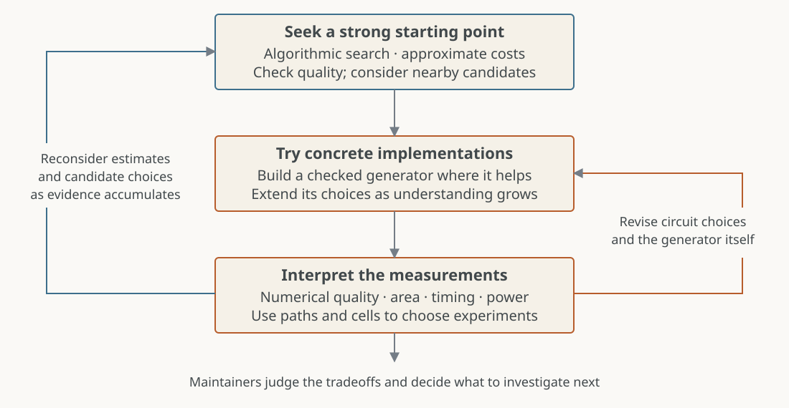

AI models can help search,
write and check implementations, and investigate EDA reports. Project
maintainers bring the context to decide what to build, which quality and PPA
tradeoffs are acceptable, and when further experiments are worthwhile.
