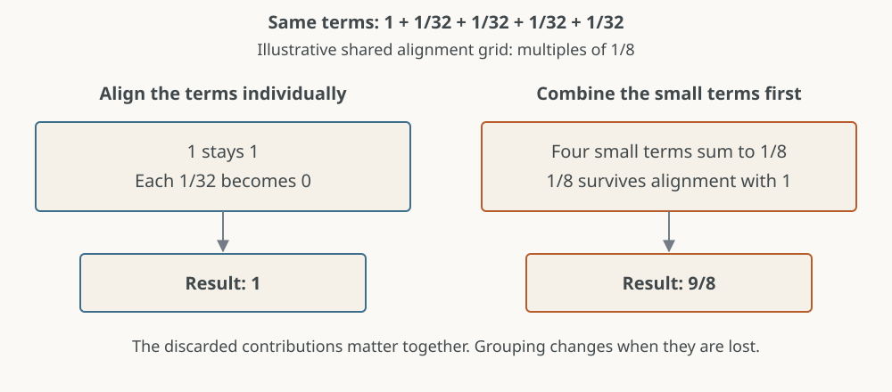
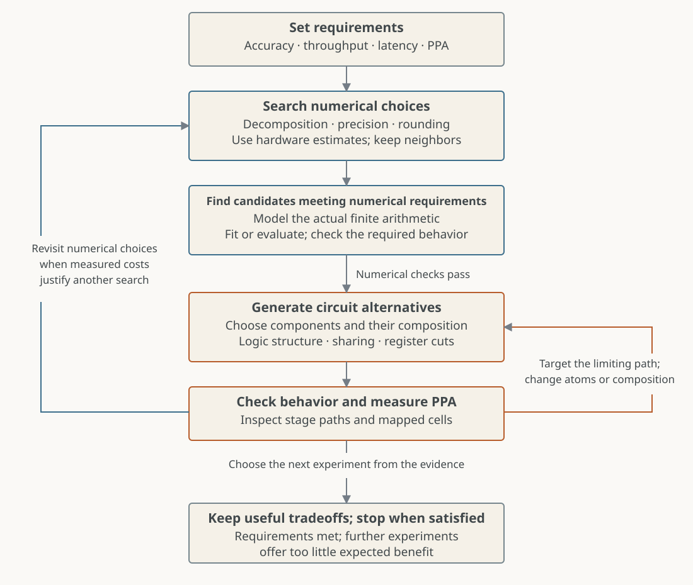

A hardware design starts before RTL. We choose the computation, its numerical
precision and where it rounds. We then choose how to implement it: which
operations share logic, how dependencies are organized, and where registers go.
Both sets of decisions affect accuracy, area, timing and power.

Our approach is to search numerical choices using informed hardware estimates,
generate implementations of promising candidates, and use measurements to choose
the next experiments. Because the estimates are approximate, we also investigate
neighboring candidates. The measured circuit can change which computation is
worth searching next.

The [exponential hardware series](../index.qmd) provides our worked experiments.
Dot-product engines and constant multiplication provide two other concrete
examples of where the same decisions arise.

## Choose what the search can change

The first decision is which alternatives belong in the search. An optimizer
cannot discover an option we have excluded from its model.

For our exponential, the choices included table size, coefficient formats,
intermediate precision and rounding operations. Each combination defined an
arithmetic model. Remez supplied starting coefficients; the automated fitter
then searched coefficient words for that model. Changing a format or rounding
operation required another fit.

This distinction matters: we chose the hardware experiments, while the fitter
searched within each experiment. Automating that inner search made it practical
to investigate computations whose coefficients would be difficult to choose by
hand.

A dot product presents a different numerical choice. Instead of updating a
floating-point accumulator after every product, a circuit can align several
products to their maximum exponent, sum their significands, and normalize the
combined result. The number of products grouped together and the retained
alignment width become design parameters.

Finite alignment width can discard contributions before they combine. Suppose
the retained positions represent multiples of $1/8$. In

$$1+\frac1{32}+\frac1{32}+\frac1{32}+\frac1{32}=\frac98,$$

each small term disappears if rounded individually to that grid. Combined first,
the four small terms produce $1/8$, which survives. Smaller groups do not always
produce better answers, but grouping and retained precision must be considered
together.

The numerical requirement determines which candidates are acceptable. Our
exponential required exhaustive checks of the FP32 model, including its error
bound and monotonicity. A dot-product study would need its own stated accuracy
requirements and input coverage, including exponent differences and cancellation.
Agreement with one particular accumulation order is a different requirement from
closeness to the exact dot product.

## Use estimated costs to choose experiments

Evaluating every numerical candidate through a complete hardware flow is
expensive. Approximate costs help decide where to spend that effort.

The estimate needs to represent the tradeoff being searched. For our exponential,
more table entries increase lookup work but shorten the approximation intervals,
potentially permitting narrower arithmetic. Comparing table sizes at fixed
arithmetic widths would miss much of that opportunity. When the 256-row fit
proved more accurate at unchanged widths, we investigated smaller coefficients
and intermediate results.

Even an operation count can hide a large difference. Consider computing both
$49x$ and $51x$ using shared shifts and additions. Garcia and Volkova give two
graphs with three additions each, but their three-bit-input example requires
**22 one-bit adders in one graph and 9 in the other**. Their search incorporates
adder widths, and can jointly choose intermediate truncations and graph
structure under an output error bound. Allowing truncation can change the
preferred graph, rather than merely shrink an existing one.
[Their paper](https://arxiv.org/html/2210.02742) connects these models to generated
VHDL and FPGA implementation results.

The purpose of the cost estimate is to make those differences visible early.
Its preferred candidate is a starting point for measurement. We also want nearby
table sizes, widths or arithmetic structures whose estimated costs are close,
especially where a small parameter change can remove a whole hardware structure.
In our exponential, reducing a first result from 16 to 15 bits removed a recoded
row from the next multiplier as well as reducing storage.

## Generate implementations of a chosen computation

Once a numerical candidate passes its checks, we temporarily fix its arithmetic
behavior and explore circuits that implement it.

We choose the circuit components and their alternatives explicitly. Our
exponential generator varies Booth recoding, compressor grouping, carry
completion and register cuts. It also connects operands to the correct stages
and propagates constant bits. These bookkeeping tasks are part of making each
experiment correct.

The generator makes it practical to change one choice without manually rebuilding
every dependent path. Its checks establish that the resulting circuit preserves
the chosen arithmetic. Moving a register can preserve the computation; moving a
rounding operation may change it and require a new numerical search.

For a grouped dot product, the corresponding choices would include the
maximum-exponent network, alignment shifters, reduction network and accumulator
placement. We would choose those components for that problem. The useful
abstraction is a family of concrete implementations with checked behavior.

## Measure alternatives and explain the differences

Measurements do more than rank candidates. They reveal which part of our
reasoning needs to change.

In one exponential experiment, removing an RNE operation appeared to promise
less logic. Refitting changed the largest coefficient word from **510 to 512**.
A previously constant bit became variable, restoring lookup, storage and
multiplier logic. The complete circuit became slightly larger. An estimate
based only on declared widths and rounding operations missed the effect of the
fitted words.

The implementation path matters too. At 800 ps, changing carry completion let
our four-cycle pipeline meet timing. At 700 ps, compression organization and
additional register cuts produced different area, latency and timing-margin
tradeoffs. We chose experiments by locating the limiting stage and tracing its
dependencies. A faster block elsewhere would not resolve that failure.

A published dot-product design illustrates the same reasoning. Intel's NNP-T
uses 32-product block alignment with a 37-bit internal path and adds the
accumulator afterward. Its early timing was dominated by maximum-exponent and
alignment calculations. That left room to optimize significand multipliers for
area and power rather than minimum delay.
[The design paper, §III](https://www.acsel-lab.com/arithmetic/arith27/pdfs/ARITH2020-38ozUqVB9oR8ZyQdVxXcK/712000a133/712000a133.pdf)
explains both the numerical choices and their implementation consequences.

A useful estimate can still misorder individual objectives. In Garcia and
Volkova's HP5 benchmark, changing the search objective reduces FPGA LUTs from
**42 to 41**, while delay increases from **7.506 to 8.574 ns**. The smaller
implementation is not the faster one.
[Table III](https://arxiv.org/html/2210.02742) reports both, allowing the target
constraints to determine which is useful.

Our exponential measurements cover synthesis and cell mapping. Placement,
routing and clock-tree construction would provide further evidence and could
change the next experiment. The implementation stage used for each comparison
belongs alongside its results.

## Feed the results back into the search

There are two useful directions after measurement. If the computation is
promising but a particular stage misses timing, we can change its circuit
organization. If the cost comes from the chosen precision or decomposition, we
can revisit the numerical design and fit again.

For the exponential, that might mean investigating a neighboring table size
with narrower arithmetic. For a dot product, it might mean investigating another
group size with a different retained alignment width. The numerical model must
account for the resulting rounding behavior before we compare hardware.

This is why we keep several candidates rather than commit to the lowest estimated
cost. A fitted constant can eliminate logic; a width reduction can remove a
multiplier row; a new register cut can reduce delay while increasing storage.
Measurements tell us which of these effects actually occurred.

We stop when the requirements are met and further experiments offer too little
expected benefit. Where area, accuracy, latency or power remain in conflict,
the result is a set of measured alternatives with an explanation of their
differences.

The method depends on both automation and judgment. Automated fitting searches
numerical combinations; generated RTL makes implementation experiments
repeatable. We choose the alternatives worth expressing and use the evidence
to decide what to investigate next.
